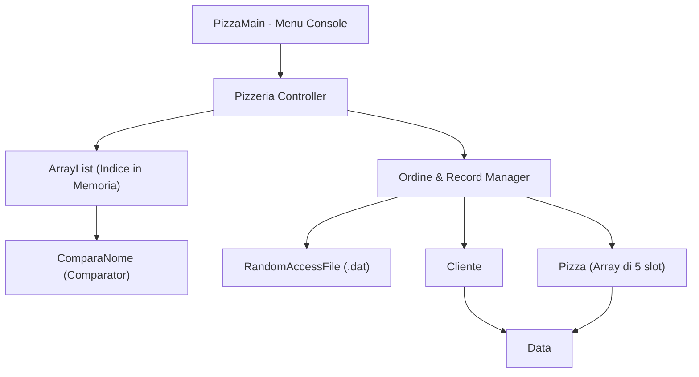

# Requirements

### Overview & Goals
Il progetto **PizzeriaPlus** (sviluppato per la materia Informatica - classe 5G) ha lo scopo di gestire gli ordini di una pizzeria tramite:
1. Strutture dati in memoria (array di ordini e array di pizze per ordine).
2. Persistenza su file binario ad accesso diretto (**`RandomAccessFile`**) con **record a lunghezza fissa**.
3. Gestione di un **indice in memoria** (`ArrayList<Item>`) ordinato alfabeticamente tramite `ComparaNome` (`Comparator<Item>`) per consentire la ricerca rapida per chiave (nome cliente).
4. Menu interattivo da riga di comando per consentire l'inserimento, la visualizzazione, la ricerca e l'aggiornamento degli ordini.

---

### Valutazione dello Stato Attuale del Progetto
- **Punti di Forza**:
  - L'architettura concettuale è ben delineata e aderente agli standard didattici di 5ª superiore (approccio file a record fissi + indice di ricerca).
  - La suddivisione in classi (`Data`, `Cliente`, `Pizza`, `Ordine`, `Item`, `ComparaNome`, `Pizzeria`, `PizzaMain`) è corretta e modulare.
  - Alcune logiche di calcolo (es. `calcolaTotale()` in `Ordine`) sono già impostate correttamente.

- **Criticità e Parti Incomplete da Risolvere**:
  1. **Dimensioni dei Record & Formato Dati**: `CLIENTE_DIM` e `PIZZA_DIM` calcolano le dimensioni assumendo stringhe da 20 byte, ma le stringhe Java richiedono una gestione esplicita a lunghezza fissa (padding con spazi o caratteri null, oppure lettura/scrittura byte per byte/carattere per carattere). Il float è contato come 8 byte in `Pizza` invece di 4 byte.
  2. **I/O con `RandomAccessFile`**: `Pizzeria.salvaOrdine()` contiene solo commenti e pseudocodice. Mancano la scrittura effettiva, la gestione degli slot vuoti per le 5 pizze di ogni ordine, la lettura (`seek` + read) e il popolamento dell'indice.
  3. **Classe `Item` e `ComparaNome`**: `Item` non ha metodi di accesso né costruttore completo. `ComparaNome` implementa `Comparator<String>` anziché `Comparator<Item>`.
  4. **Pizzeria**: Mancano i metodi di caricamento da file, ricerca per indice, aggiornamento stato ordine.
  5. **`PizzaMain`**: Il metodo `main` è completamente vuoto, privo di interfaccia utente.

---

### Scope
- **In Scope**:
  - Standardizzazione dei modelli di dati e delle funzioni di serializzazione/deserializzazione a record fisso.
  - Completamento di `Item` e `ComparaNome`.
  - Completamento della classe `Pizzeria` con I/O su `RandomAccessFile`, gestione indice e ricerca binaria.
  - Creazione del menu console interattivo in `PizzaMain`.
- **Out of Scope**:
  - Interfaccia grafica (GUI Swing/JavaFX).
  - Database relazionali SQL (l'obiettivo didattico è l'uso esplicito di `RandomAccessFile`).

---

### Functional Requirements
- **FR-1 [Inserimento Ordine]**: L'utente può creare un ordine specificando cliente, orario/ritiro, e fino a 5 pizze con quantità e prezzo.
- **FR-2 [Salvataggio su File Binario]**: L'ordine viene salvato nel file `.dat` in un record a dimensione fissa calcolata.
- **FR-3 [Indicizzazione]**: A ogni salvataggio, un elemento `Item(nomeCliente, recordIndex)` viene aggiunto all'indice e mantenuto ordinato.
- **FR-4 [Ricerca Ordine]**: Possibilità di cercare un ordine tramite nome cliente usando l'indice ordinato e recuperare i dettagli tramite `seek()`.
- **FR-5 [Visualizzazione e Stato]**: Elenco di tutti gli ordini registrati con possibilità di contrassegnare un ordine come "pronto" o "consegnato".

# Technical Design

### Architecture Overview
Il sistema segue il classico pattern per la gestione di file ad accesso diretto con indice:



---

### Key Decisions
1. **Convenzione Stringhe a Lunghezza Fissa**:
   - Fissiamo la lunghezza massima delle stringhe (nome cliente, nome pizza) a `MAX_CHARS = 20`.
   - Utilizzo di metodi helper `writeFixedString(RandomAccessFile f, String s, int length)` e `readFixedString(RandomAccessFile f, int length)` che scrivono/leggono esattamente `length` caratteri (utilizzando `writeChars` per 2 byte per carattere oppure `writeBytes` a 1 byte per carattere). Fissando 1 byte per carattere ASCII (`writeBytes`/lettura byte), 20 caratteri = 20 byte.

2. **Calcolo della Dimensione Record**:
   - `Data`: `hour` (int = 4), `min` (int = 4) -> **8 byte**.
   - `Cliente`: `nome` (20 byte) + `ritiraDopo` (boolean = 1 byte) + `ritiro` (Data = 8 byte) + `numOrdine` (int = 4 byte) -> **33 byte**.
   - `Pizza`: `nome` (20 byte) + `price` (float = 4 byte) + `quantita` (int = 4 byte) + `wait` (boolean = 1 byte) + `consegna` (Data = 8 byte) + `presente` (boolean flag = 1 byte) -> **38 byte**.
   - `Ordine`: 5 * `Pizza` (5 * 38 = 190 byte) + `pronto` (1 byte) + `cliente` (33 byte) + `numOrdine` (4 byte) + `total` (float = 4 byte) + `consegnato` (1 byte) -> **233 byte** fissi per record.

3. **Gestione dell'Indice in Memoria**:
   - L'indice contiene oggetti `Item` con `key` (nome cliente o numOrdine) e `posizione` (numero record o offset in byte).
   - `ComparaNome` implementa `Comparator<Item>` confrontando `item1.getKey().compareToIgnoreCase(item2.getKey())`.
   - La ricerca usa `Collections.binarySearch`.

---

### Data Models & Contracts

#### `Item.java`
```java
public class Item {
    private String key;
    private int posizione; // indice del record (0, 1, 2, ...)

    public Item(String key, int posizione) { ... }
    public String getKey() { return key; }
    public int getPosizione() { return posizione; }
}
```

#### `ComparaNome`
```java
import java.util.Comparator;

public class ComparaNome implements Comparator<Item> {
    @Override
    public int compare(Item o1, Item o2) {
        return o1.getKey().compareToIgnoreCase(o2.getKey());
    }
}
```

#### `Ordine.java` - Metodi I/O
```java
public void scriviRecord(RandomAccessFile f) throws IOException {
    // 1. Scrittura del cliente
    // 2. Scrittura delle 5 pizze (con boolean flag slot occupato/vuoto)
    // 3. Scrittura dati ordine: numOrdine, total, pronto, consegnato
}

public static Ordine leggiRecord(RandomAccessFile f) throws IOException {
    // Lettura sequenziale dei campi a dimensione fissa
}
```

#### `Pizzeria.java` - Metodi Principali
- `public void salvaOrdine(String fileName, Ordine ordine)`: Salva il record nel file alla posizione `nOrdini * DIM_RECORD` e inserisce `Item` nell'indice ordinato.
- `public Ordine caricaOrdine(String fileName, int recordIndex)`: Esegue `f.seek(recordIndex * DIM_RECORD)` e deserializza l'ordine.
- `public Ordine cercaOrdinePerCliente(String fileName, String nomeCliente)`: Esegue la ricerca binaria nell'indice e carica l'ordine corrispondente.
- `public void caricaTuttiDaFile(String fileName)`: Ricostruisce array ordini e indice all'avvio.

# Testing

### Validation Approach
I test verranno verificati tramite esecuzione del programma `PizzaMain` e scenari dedicati di I/O su file temporanei `.dat`.

---

### Key Scenarios
1. **Creazione e Salvataggio Ordine**:
   - Inserire un ordine con 2 pizze (Margherita e Diavola) e 3 slot vuoti.
   - Verificare che il file `.dat` cresca esattamente di `DIM_RECORD` byte.
   - Verificare che l'indice `ArrayList<Item>` contenga il nome cliente associato all'indice record 0.

2. **Ricerca tramite Indice**:
   - Inserire 3 ordini con clienti non in ordine alfabetico (es. "Zack", "Alice", "Marco").
   - Eseguire la ricerca per "Alice": verificare che l'indice trovi la posizione corretta e che `caricaOrdine` legga i dati esatti dal file.

3. **Persistenza e Riavvio**:
   - Riavviare il programma e invocare il caricamento degli ordini dal file `.dat` esistente: verificare che tutti gli ordini vengano ripristinati correttamente in memoria e che l'indice venga ricostruito.

4. **Modifica Stato Ordine**:
   - Contrassegnare un ordine come "pronto" o "consegnato" e verificare l'aggiornamento su file tramite sovrascrittura mirata con `seek()`.

---

### Edge Cases
- Nome cliente o pizza più lungo di 20 caratteri (troncamento corretto).
- Nome cliente o pizza più corto di 20 caratteri (padding corretto con spazi/null senza alterare la dimensione del record).
- Ricerca di un cliente inesistente (restituzione di `null` o messaggio esplicativo senza crash).
- Lettura da file vuoto o non esistente (gestione controllata dell'`IOException` con creazione automatica del file).

# Delivery Steps

###   Step 1: Completamento e standardizzazione dei modelli base (Data, Cliente, Pizza, Item, ComparaNome)
Garantire che tutti i componenti base contengano campi, costruttori, getter/setter, metodi di utilità e una definizione coerente della dimensione in byte per il record a lunghezza fissa.

- Correggere e uniformare il calcolo di dimensione record in `Cliente.java` e `Pizza.java` (gestione stringhe a lunghezza fissa con padding/troncamento a 20 caratteri).
- Implementare i metodi di lettura e scrittura su `RandomAccessFile` (o metodi helper di conversione byte/record) per `Data`, `Cliente` e `Pizza`.
- Completare `Item.java` con costruttori, getter/setter per chiave (`key`) e puntatore (`posizione`/offset nel file).
- Aggiornare `ComparaNome` per implementare `Comparator<Item>` e consentire l'ordinamento alfabetico dell'indice per nome cliente.

###   Step 2: Completamento della classe Ordine e gestione serializzazione record fisso
Completare la logica interna dell'ordine, il calcolo della dimensione totale del record `DIM_ORDINE` e le funzioni di I/O binario.

- Completare la gestione dell'array di pizze (fino a 5 pizze per ordine), aggiungendo metodi per inserire pizze, validare gli slot e calcolare il totale.
- Implementare i metodi `scriviRecord(RandomAccessFile f)` e `leggiRecord(RandomAccessFile f)` all'interno di `Ordine.java` per garantire che ogni record occupi esattamente `DIM_ORDINE` byte (gestendo gli slot null con valori predefiniti/placeholder).
- Fornire metodi di stato (pronto, consegnato) e formattazione per la stampa dettagliata dell'ordine a schermo.

###   Step 3: Implementazione della classe Pizzeria (I/O RandomAccessFile, Indice e Ricerca)
Realizzare la gestione centrale della pizzeria: salvataggio su file binario ad accesso casuale (`RandomAccessFile`), caricamento, mantenimento e aggiornamento dell'indice `ArrayList<Item>`, e ricerca.

- Completare `salvaOrdine(String fileName, Ordine ordine)`: scrittura del record alla fine del file o in una posizione specifica, aggiornamento dell'array in memoria e inserimento della voce corrispondente nell'indice `ArrayList<Item>`.
- Implementare `caricaOrdine(String fileName, int posizione)` per recuperare un singolo ordine tramite `seek()`.
- Implementare il caricamento completo degli ordini da file all'avvio della pizzeria e la ricostruzione dell'indice.
- Implementare la ricerca per nome cliente (`ricercaPerCliente`) sfruttando l'indice e la ricerca binaria (`Collections.binarySearch` tramite `ComparaNome`).
- Aggiungere metodi per aggiornare lo stato di un ordine su file e calcolare statistiche di vendita.

###   Step 4: Sviluppo dell'interfaccia utente console (PizzaMain) e test integrato
Fornire un'interfaccia a riga di comando completa e robusta in `PizzaMain.java` che permetta all'utente di testare e utilizzare tutte le funzionalità della pizzeria.

- Implementare un ciclo interattivo con menu a scelte numerate (es. 1. Inserisci ordine, 2. Visualizza ordini, 3. Cerca ordine per cliente, 4. Aggiorna stato ordine, 5. Salva/Carica su file, 0. Esci).
- Gestire l'input da tastiera con `Scanner` e controllo delle eccezioni (gestione errori di formato e input non valido).
- Precaricare dati di prova per facilitare la dimostrazione e il collaudo del progetto.